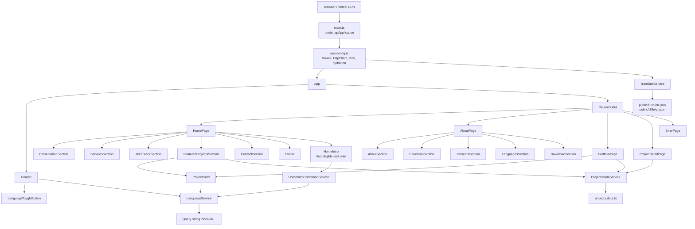

# Architecture

## Overview

Terminal Portfolio is a standalone, feature-organized Angular application. There is no `AppModule` and no feature modules: providers are registered in `ApplicationConfig`, pages are loaded with `loadComponent`, and each component declares its template dependencies directly.

The build combines:

- browser-side rendering;
- static prerendering of the known public pages;
- client-side hydration;
- static output hosted by Vercel.

## Component diagram



## Layers and responsibilities

### Bootstrap and configuration

- `src/main.ts`: bootstraps `App` in the browser.
- `src/app/app.config.ts`: registers Router, scroll restoration, preloading, hydration, HttpClient, ngx-translate, and the `SeoService` initializer.
- `src/main.server.ts`: adapts the bootstrap process to the rendering context. The app is zoneless, so it adds no change-detection provider.
- `src/app/app.config.server.ts`: merges the browser providers with `provideServerRendering`.

### Application shell

`App` is the global shell. It keeps `Header` visible, delegates page content to
`RouterOutlet`, and eagerly creates `LanguageService`. Locale ownership and
translation loading are not duplicated in the shell.

### Features

| Feature | Responsibility | Main components |
| --- | --- | --- |
| `home` | Presentation, services, stack, featured projects, and contact. | `HomePage` and five sections. |
| `about` | Biography, education, interests, languages, and résumé. | `AboutPage` and five sections. |
| `portfolio` | Full project catalog listing. | `PortfolioPage`, `ProjectCard`. |
| `projectDetail` | Resolves `:id` and displays a single project. | `ProjectDetailPage`. |
| `error` | Shows a visual response for unknown routes. | `ErrorPage`. |

### Home intro lifecycle

`HomeIntroService` is a root-provided, in-memory state machine with five states:

```text
unclassified ── first recognized URL is "/" ──────────► eligible
     └── first recognized URL is anything else ─────► completed
eligible ── browser post-hydration claim ──► waiting
  └── reduced motion ──────────────────────► completed
waiting ── active catalog + command ready ──► typing
waiting ── catalog unavailable / reduced motion / route destruction ──► completed
typing ── final character + final pause ──────────────► completed
typing ── route destruction / reduced motion ────────► completed
```

Only the very first navigation can be `eligible`, so the intro plays once per
page load and never when the visit starts on another page.

`HomePage` owns the structural rendering boundary. `HomeIntro` and its terminal
shell remain mounted across the transition. While the service is `unclassified`,
`eligible`, `waiting`, or `typing`, every secondary `@if` block is absent. Presentation content, services,
stack, projects, contact, and footer are created only in `completed` and are
inserted immediately with their final styles, without a secondary animation.
Consequently, secondary hooks, image loads, observers, and other side effects
cannot run during typing, while the terminal component and DOM node keep the
same identity.

`HomeIntroCommandService` derives a discriminated command state directly from
the catalog exposed by `LanguageService`: `waiting`, `ready`, or `unavailable`.
It never uses the temporary return value of a translation pipe. `HomeIntro`
freezes the first ready command for the duration of typing, so a language change
cannot mix two commands. Once completed, later resolved catalogs can update the
display without replaying the intro.

`HomeIntro` owns one recursively scheduled timeout. Each callback appends one
Unicode code point and schedules at most one successor. It clears the pending
timeout on destruction and reports completion only after the last character is
present. A catalog error completes without typing or exposing a raw key, so the
rest of the site is not permanently blocked.

The sequence is configured in
`src/app/features/home/home-intro.config.ts`. `HOME_INTRO_CONFIG` controls the
initial delay, per-character interval, final pause, and cursor blink. Translated
command text remains in `public/i18n`.

Browser-only startup and `matchMedia` access run inside `afterNextRender`, which
Angular skips during server rendering and runs after hydration. The server and
initial browser render therefore agree on the intro-only tree. A non-home
initial route never constructs `HomeIntro` and does not consume the sequence.
Reduced-motion users transition to the complete tree at that post-hydration
boundary without typing or an unnecessary delay. If their catalog is still
loading, the terminal remains empty until the resolved command becomes
available.

### Core and shared

- `core/layout`: structural components, including the header, footer, and the visual composition that simulates a terminal.
- `core/i18n`: `LanguageService` (the language of the URL, the catalog state, and the current path as a signal) and `LanguagePreference` (the remembered or browser language).
- `core/seo`: `SeoService`.
- `core/shared`: reusable UI elements, such as the button, title, language toggle, project card, and `Carousel` (a row of slides that rests on one at a time, with previous and next buttons and a dot for each place it can rest; the browser does the scrolling and snapping with CSS `scroll-snap`, the component only measures where the stops are and moves the track to one; it follows the WAI-ARIA carousel pattern, without rotation, and the featured projects of the home page use it), and two helpers they share: `isPlainLeftClick` (`plain-left-click.ts`), which every in-app link uses to leave Ctrl/Cmd/Shift/Alt and middle clicks to the browser, and the `OverflowWatch` directive, which tells whether a row scrolls sideways so the "scroll sideways" hint of the About page's download row shows only then. The main navigation's pages are the `NAV_ROUTES` constant in `core/layout/header/nav-routes.ts`; a test checks each one is a real, prerendered route.

### Change detection

The application is zoneless: zone.js is neither a dependency nor a polyfill, in
the build or in the tests. Angular checks a component again when a signal read in
its template changes, when one of its template or host listeners fires, when an
input is set, or when something calls `markForCheck`. That is why everything a
template shows is held in signals, and why the header's active link follows
`LanguageService`'s path signal without any manual refresh. Prerendering needs
no zone either: Angular tracks the router and `HttpClient` requests itself, so
the catalog fetch is awaited before the page is serialized. The hydration check
used when this was introduced marks the server-rendered nodes and confirms the
browser keeps the same nodes.

### Data and services

`projects.data.ts` is the local, typed source of the catalog. There is no remote API and no persistent storage. The technology badges of a project are drawn from its `badges` into `public/images/badges` by `npm run badges`, and `project-badges` shows those files. `ProjectsDataService` exposes three read-only operations:

- list all projects;
- find a project by id;
- filter featured projects.

`LanguageService` tracks `NavigationEnd`, normalizes the locale, owns the
`TranslateService.use()` subscription, preserves the locale across navigation,
updates `<html lang>`, and publishes a signal-based catalog state. A stale load
cannot overwrite a newer URL language. `TranslateService` remains responsible
for fetching and storing catalogs. On the first navigation only, it asks
`LanguagePreference` (remembered choice in `localStorage`, then the browser's
language list; browser-only) which language to use when the URL has no
`?locale=`.

Switching the language is a navigation to the same page with another `?locale=`.
The router scrolls to the top on every new navigation (scroll restoration is
`enabled` in `app.config.ts`), which is right for another page but not for the
same page in another language, so `toggleLanguage` navigates with
`scroll: 'manual'` and the reader stays where they were. `language.service.spec.ts`
runs this against the router's real scroller.

Catalogs reach the browser two ways. The prerendered pages are English and carry
the English catalog in the HTML as transfer state, so `TranslateService` finds it
without a request. The Portuguese catalog is fetched; `src/index.html` starts
that fetch with a `preload` link while the scripts download (an inline script
that follows the same rule as `LanguageService` and `LanguagePreference`;
`catalog-preload.spec.ts` keeps them in agreement), so the request does not wait
for the application to bootstrap.

`SeoService` (`providedIn: 'root'`, started by an app initializer) reads each
route's `data.seo` and, whenever the route or the catalog state changes, sets the
title, description, canonical URL, `hreflang` alternates, and social tags. It
runs during prerendering, so the static HTML is already complete. Pages that
cannot be indexed (unknown routes, unknown project ids) get `noindex` and no
canonical URL. Site-wide constants (the canonical host, the default social
image) are in `src/app/data/site.config.ts`.

## Routes and rendering

| Route | Page | Loading | Rendering |
| --- | --- | --- | --- |
| `/` | `HomePage` | Lazy | Prerendered |
| `/about` | `AboutPage` | Lazy | Prerendered |
| `/portfolio` | `PortfolioPage` | Lazy | Prerendered |
| `/portfolio/:id` | `ProjectDetailPage` | Lazy | Prerendered (one page per catalog project) |
| `404` | `ErrorPage` | Lazy | Prerendered (becomes `404.html`) |
| `**` | `ErrorPage` | Lazy | Client |

The build uses `outputMode: "static"`. The prerendering step generates HTML for the static routes and for each project (`getPrerenderParams` reads the catalog), and a CSR shell for the client-rendered fallback. `portfolio/:id` has a `canMatch` guard (`projectExistsGuard`), so an id that is not in the catalog falls through to `**` and shows the not-found page.

Unknown addresses get a real 404 status. The `404` route is prerendered, and the build ends with `scripts/create-build-output.mjs`: it copies `404/index.html` to `404.html` and writes a Build Output API v3 directory (`.vercel/output`, git-ignored) with an explicit routing table: the security headers from `vercel.json`, then real files, then `404.html` with a 404 status. The explicit output is needed because Vercel's builder detects `@angular/cli` from `package.json` even under the "Other" preset and applies the Angular preset's catch-all rewrite to `index.html` (a 200 for every miss); a prebuilt output makes it skip the framework's routes. The page hydrates at the requested URL, shows that path, and `SeoService` marks it `noindex`. The consequence: there is no SPA fallback, so every real page must be prerendered (`app.routes.spec.ts` enforces this).

## Project data flow

```text
projects.data.ts
      │
      ▼
ProjectsDataService
      ├── getFeaturedProjects() ──► FeaturedProjectsSection
      ├── getAllProjects() ───────► PortfolioPage
      └── getProjectById(id) ─────► ProjectDetailPage
                                         ▲
                                         │ :id
ProjectCard ── locale-aware navigation ──► Router
```

Components receive typed `Project` objects. Titles and descriptions are not stored in this catalog; they are resolved from the translation files, using the id as part of the key.

## Language flow

1. `LanguageService` reads `locale` from each completed navigation.
2. The locale is normalized to `en` or `pt` and published as `loading`.
3. `TranslateService.use()` loads `public/i18n/<language>.json`.
4. Only the winning request publishes `ready`; errors publish `failed`.
5. `TranslatePipe` updates regular templates while command-sensitive flows use
   the resolved catalog state directly.
6. Locale-aware links preserve standard browser behavior and the language
   button updates the URL.

English is the fallback language and the default for the server, for crawlers, and for visitors whose browser does not prefer Portuguese. The loader is configured with `failOnError: true`; a missing catalog is treated as an error instead of silently resulting in empty translations.

## Styles

Each component has encapsulated SCSS. Shared styles live in `src/styles`:

- `abstracts/_variables.scss`: tokens and variables;
- `abstracts/_mixins.scss`: `page-gutter`, the one fluid side gutter (`clamp(0.5rem, 4vw, 8rem)`) that every page takes through `page-shell` and the sticky header takes directly, so the header is always exactly as wide as the sections below it (`layout-gutter.spec.ts` checks the source, since jsdom does not compute layout);
- `abstracts/_fonts.scss`: the self-hosted JetBrains Mono `@font-face` declarations;
- `styles.scss`: global stylesheet registered in `angular.json`.

`stylePreprocessorOptions.includePaths` allows importing resources from `src/styles`.

JetBrains Mono is served from `public/fonts` instead of Google Fonts. Google
distributes it as a single variable-weight binary per Unicode subset — every
static weight resolves to the same file, so self-hosting only needs the
`latin` and `latin-ext` subsets (English and Brazilian Portuguese, including
accented characters) declared with `font-weight: 100 900`. This removes the
`fonts.googleapis.com` / `fonts.gstatic.com` requests entirely: no visitor IP
reaches Google before the page renders, and the two DNS/TLS round trips that
previously preceded the stylesheet fetch are gone. See
`public/fonts/README.md` for provenance and how to refresh the files.

## Testing

The `@angular/build:unit-test` builder runs Vitest on top of jsdom. Every
component has a spec file, and a component that shows catalog content is checked
against the catalog itself, so a rendering regression (a list that stops
rendering, a link with the wrong address) fails a test. Intro tests use
controlled catalog states and cover delayed loads, both languages, stale
completion, failures, navigation interruption, reduced motion, Unicode, and
one-run behavior. The production build additionally verifies SSR/SSG
compilation and prerendering.

Three layers sit beside the component specs. Data and wiring checks catch what no
compiler does: that every project image exists and every project has both
languages' texts (`projects.data.spec.ts`), that every translation key written in
a template exists in both catalogs (`translation-keys.spec.ts`), and that each
route loads the page it names and receives its parameters (`app.routes.spec.ts`).
The build scripts, which decide the headers, the caching, and the 404 in
production, are plain Node and have their own tests (`npm run test:scripts`,
with the `node:test` runner and a coverage floor). And coverage is measured over
the whole of `src/app` with a floor that CI enforces (`npm run test:coverage`; see
the README for what is left out and why).

`src/test-setup.ts` loads the real English catalog, so specs check what visitors
read. Tests run zoneless, like the application. Specs that depend on `afterNextRender` must call `TestBed.tick()`:
since Angular 22.2 `fixture.detectChanges()` no longer runs those hooks. The
GitHub Actions workflow `ci.yml` runs the linter, the suite with its coverage
floor, the script tests, and the production build on every push and pull request
(see the README).

## Build and delivery

```text
Source code
   │ npm ci
   ▼
Angular 22 build + prerender
   │
   └── dist/portfolio/browser
             │
             ▼
        Vercel Edge CDN
```

`vercel.json` runs `npm ci` and `npm run build` and publishes only `dist/portfolio/browser`; the build also writes the `.vercel/output` routing described under "Routes and rendering" above, which is what makes unknown paths return 404. The project does not require any environment variables in its current state.

## Security headers

`vercel.json` attaches a `headers` rule matching every path, since the site
has no server running at request time to set headers dynamically — the
Vercel CDN applies them to the static output directly. It sets
`Strict-Transport-Security`, `X-Content-Type-Options`, `X-Frame-Options`,
`Referrer-Policy`, `Permissions-Policy`, and `Content-Security-Policy`.

`img-src` is `'self' data:`: images come from the site itself only. The
technology badges, which used to be fetched from img.shields.io, are SVG files in
`public/images/badges` made by `npm run badges` (see the README).

Caching is set by further `headers` rules in the same file. Files whose names
carry a content hash get `public, max-age=31536000, immutable`; fonts, images and
the favicon get `public, max-age=86400, stale-while-revalidate=604800`; pages,
catalogs and CVs keep the host's default, which revalidates. Because the output
is built with the Build Output API, `scripts/create-build-output.mjs` is what
applies these rules; `scripts/lib/header-routes.mjs` translates each `source`
(literal text and regex groups only) and the build fails rather than mark an
unhashed file `immutable`.

The CSP's `script-src` and `style-src` include `'unsafe-inline'` rather than
a nonce or hash allowlist. A nonce needs a fresh value generated per
response, which a build-once static file cannot provide — the same "nonce"
would appear in every visitor's copy of the page, which is not a nonce
anymore. A hash allowlist would work, but Angular emits several inline
`<script>` elements whose content changes across builds (`ng-state`
transfer-cache data, the `ng-event-dispatch-contract` bootstrap, this
project's own JSON-LD block) and one component binds an inline
custom-property style (`terminal-line`'s cursor-blink interval). Given the
site has no user input and no backend, `'unsafe-inline'` was accepted as the
pragmatic tradeoff; revisit with a build-time hash-computation step if the
attack surface grows.
